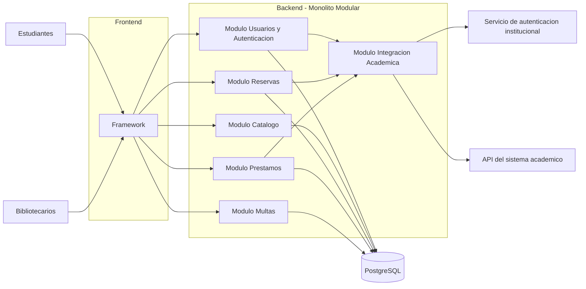
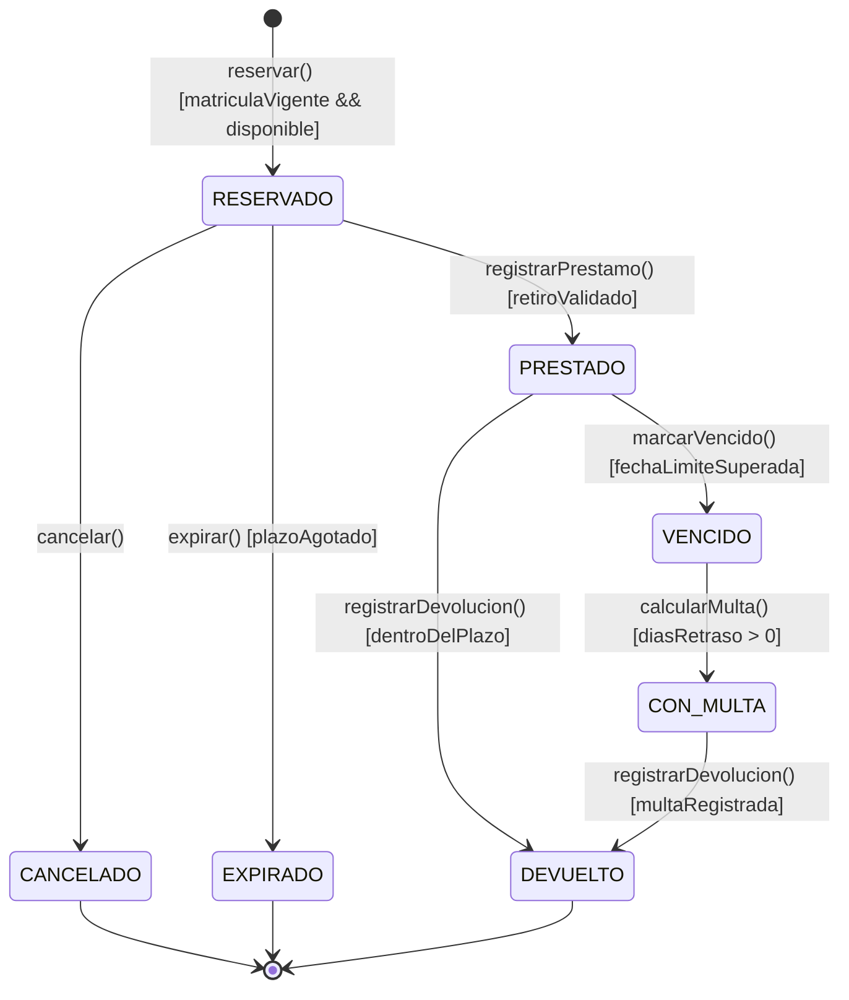
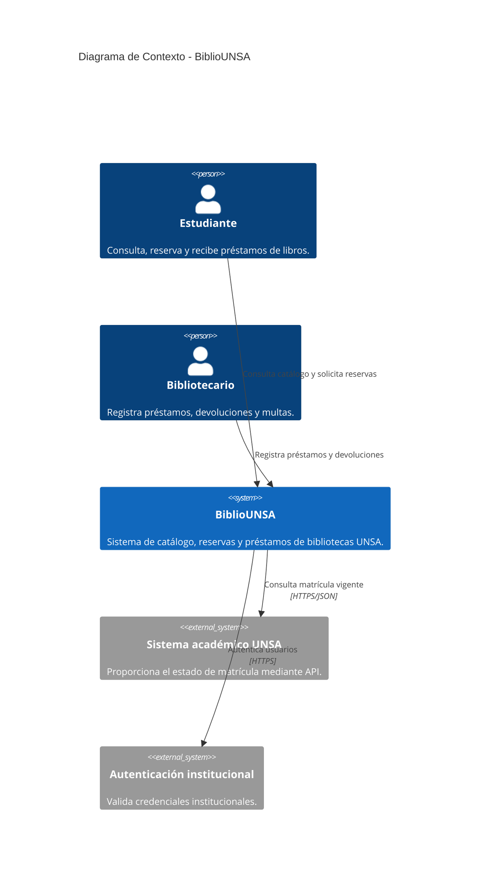
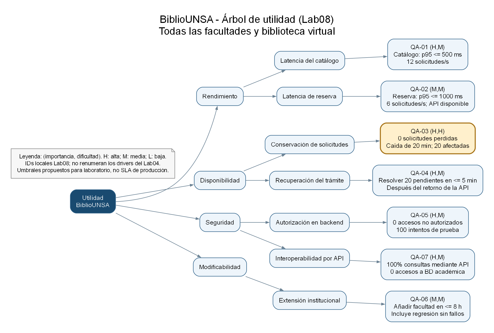

# BiblioUNSA — Laboratorio 04: Fundamentos de arquitectura de software
Construcción de Software · EPIS-UNSA · 2026-B · Grupo B

## Integrantes
| Nombre | Rol en el laboratorio |
|--------|------------------------------------------------------------------------------|
| Joaquin Alejandro Quispe Bedregal | Drivers, matriz, Mermaid, ADR-001, bitacora IA |
| Jose Leon Enrique Hatches Curo | ADR-002, PlantUML, bitacora IA |
| Romina Giuliana Camargo Hilachoque | ADR-003, despliegue, bitacora IA |

## Caso
BiblioUNSA es una plataforma para la gestión de servicios de biblioteca universitaria, en donde, los estudiantes pueden buscar libros por distintos criterios, consultar su disponibilidad, realizar reservas y gestionar cancelaciones. Los bibliotecarios pueden registrar préstamos mediante el carné QR de los estudiantes, además de administrar multas y devoluciones. El sistema también debe integrarse con los servicios institucionales para autenticar usuarios y validar la matrícula mediante la API del sistema académico. El atributo de calidad crítico es la seguridad e interoperabilidad, debido a que el sistema maneja información de usuarios y depende de una integración confiable con servicios externos de la universidad.

## Arquitectura elegida

## Decisiones arquitectónicas
- [ADR-001: Estilo arquitectónico](docs/architecture/adr/001-estilo-arquitectonico.md)
- [ADR-002: Base de datos](docs/architecture/adr/002-base-de-datos.md)
- [ADR-003: Integración académica](docs/architecture/adr/003-integracion-academica.md)

## Reflexión sobre el uso de la IA
La IA fue útil para proponer alternativas arquitectónicas, comparando ventajas y riesgos, lo que fue útil para la elaboración de matriz de decisión y así elegir la arquitectura para el proyecto, tomando en cuenta los requisitos y restricciones del proyecto elegido. Sin embargo, en algunos casos la IA realizó afirmaciones que no tomaban en cuenta todas las restricciones del proyecto, como la cantidad de integrantes y el tiempo que se tiene en cuenta para tener el MVP. Gracias a ello, algunas respuestas tuvieron que ser corregidas para poder aceptarlas posteriormente. En conclusión, la IA es una gran herramienta que acelera el proceso de desarrollo de forma eficaz, aunque a veces deba ser corregida.

## Diseño UML (Lab 05)

## Diagramas de diseño
- [Diagrama de clases](docs/design/img/clases.png)
- [Diagrama de secuencia del flujo crítico](docs/design/img/secuencia-reservar-libro.png)
- [Diagrama de estados](docs/design/img/estados-prestamo.png)
- [Diagrama de actividades](docs/design/img/actividades-devolver-libro.png)
- [Diagrama de paquetes](docs/design/img/paquetes.png)
- [Diagrama generado con pyreverse](docs/design/img/diagrama-clases-pyreverse.png)

---

## Arquitectura C4 (Lab 06)

El modelo C4 de BiblioUNSA describe la arquitectura del sistema en cinco vistas: contexto, contenedores, componentes, dinámica y despliegue. Todas se generan desde un modelo único escrito en Structurizr DSL.

### Diagrama de contexto

### Vistas de arquitectura

| Vista | Descripción | Diagrama |
|---|---|---|
| Contexto (Nivel 1) | Usuarios y sistemas externos de BiblioUNSA | [Ver contexto](docs/architecture/c4/img/contexto.png) |
| Contenedores (Nivel 2) | Aplicación Angular, API Django y PostgreSQL | [Ver contenedores](docs/architecture/c4/img/contenedores.png) |
| Componentes (Nivel 3) | Módulos internos del backend | [Ver componentes](docs/architecture/c4/img/componentes.png) |
| Dinámica | Flujo de reserva y validación de matrícula | [Ver dinámica](docs/architecture/c4/img/dinamica-exportada.png) |
| Despliegue | Distribución de contenedores en producción | [Ver despliegue](docs/architecture/c4/img/despliegue-exportado.png) |

### Archivos del modelo

- [Modelo único Structurizr DSL](docs/architecture/c4/workspace.dsl)
- [Inventario de elementos C4](docs/architecture/c4/inventario.md)
- [Contexto manual C4-PlantUML](docs/architecture/c4/contexto-manual.puml)
- [Comparación de diagramas](docs/architecture/c4/comparacion.md)
- [Revisión de las cinco vistas](docs/architecture/c4/revision-c4.md)
- [Explicación para público no técnico](docs/architecture/c4/explicacion.md)
- [Bitácora de IA](docs/architecture/c4/bitacora-ia.md)

Las vistas se validaron y exportaron mediante GitHub Actions a PlantUML y Mermaid, conservando una fuente única de arquitectura.

---

## Patrones de diseño (Lab 07)

### Tabla de olores

| Olor | Patrón | Prueba verificable |
|---|---|---|
| SDK académico con interfaces distintas | Strategy, Adapter, Factory | `test_adapter_nuevo_traduce_respuesta_de_sdk`, `test_factory_extiende_proveedor_sin_cambiar_servicio` |
| Cálculo de multas con condicionales | Strategy | `test_strategy_multa_nueva_sin_condicionales` |
| Reintentos duplicados | Decorator | `test_decorator_solo_reintenta_timeout` |
| Condicionales sobre préstamo | State | `test_state_rechaza_devolucion_sin_prestamo` |
| Notificación acoplada | Observer | `test_observer_permita_agregar_suscriptor_sin_modificar_servicio` |
| IA no confiable | Adapter, Decorator, Chain of Responsibility | `test_ia_cache_no_repite_llamada`, `test_ia_guardrails_bloquean_alucinaciones` |

### Metricas

| Medida | Resultado |
|---|---|
| Complejidad de clase `ServicioBiblioteca` | 6 (B) |
| Complejidad promedio | 1.71 (A) |
| Lineas de código (SLOC) | 276 |
|  Indice de mantenibilidad de `servicios.py` | 65.92 (B) |

---

## Diseño de arquitectura (Lab 08)

### Árbol de utilidad

### Tabla de iteraciones

| Escenario | Táctica | Evidencia | ¿Cumple? |
|---|---|---|---|
| QA-03 — Disponibilidad | Cola durable en PostgreSQL y procesamiento diferido | Simulación de 100 solicitudes durante una caída de 20 minutos: las pérdidas disminuyeron de 20 a 0. Se recuperaron las 20 pendientes en 4 minutos. | Sí, en simulación |
| QA-01 — Rendimiento | Índices en PostgreSQL y caché con TTL como complemento | Simulación de 1200 muestras: p95 de 830.61 ms sin optimizar, 340.79 ms con índices y 155.42 ms con índice y caché. Objetivo: p95 ≤ 500 ms. | Sí, en simulación |
| QA-05 — Seguridad | Autorización de operaciones en backend | Simulación de 100 intentos no autorizados: los accesos indebidos disminuyeron de 100 a 0. Se aprobaron cuatro pruebas de seguridad. | Sí, en simulación |

### Enlace a ADR

- [ADR-006: Rendimiento de catalogo](./docs/architecture/adr/006-rendimiento-de-catalogo.md)
- [ADR-007: Disponibilidad de integración](./docs/architecture/adr/007-disponibilidad-integración.md)
- [ADR-008: Seguridad de operaciones](./docs/architecture/adr/008-seguridad-de-operaciones.md)

### Badge de workflow de fitness functions

Se utiliza GitHub Actions para ejecutar automáticamente las fitness functions y verificar el cumplimiento de los criterios de calidad establecidos.

