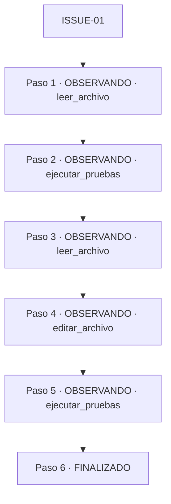

# Observación de trazas · BiblioUNSA Lab 10

## Métricas por issue

| Issue / configuración | Pasos | Rondas | Herramientas usadas | Decisiones rechazadas por contrato | Acciones bloqueadas | Contexto final (caracteres) |
|---|---:|---:|---|---:|---:|---:|
| ISSUE-01 | 6 | 6 | `leer_archivo`, `ejecutar_pruebas`, `editar_archivo` | 0 | 0 | 2906 |
| ISSUE-02 · Agente único | 4 | 4 | `ejecutar_pruebas`, `editar_archivo` | 0 | 0 | 1310 |
| ISSUE-02 · Multiagente | 8 | 8 | `ejecutar_pruebas`, `editar_archivo`, `ver_cambios` | 0 | 0 | 2512 |
| ISSUE-03 | 10 | 10 | `leer_archivo`, `ejecutar_pruebas`, `editar_archivo`, `ver_cambios` | 0 | 0 | 4405 |

## Diagrama de trayectoria: ISSUE-01

